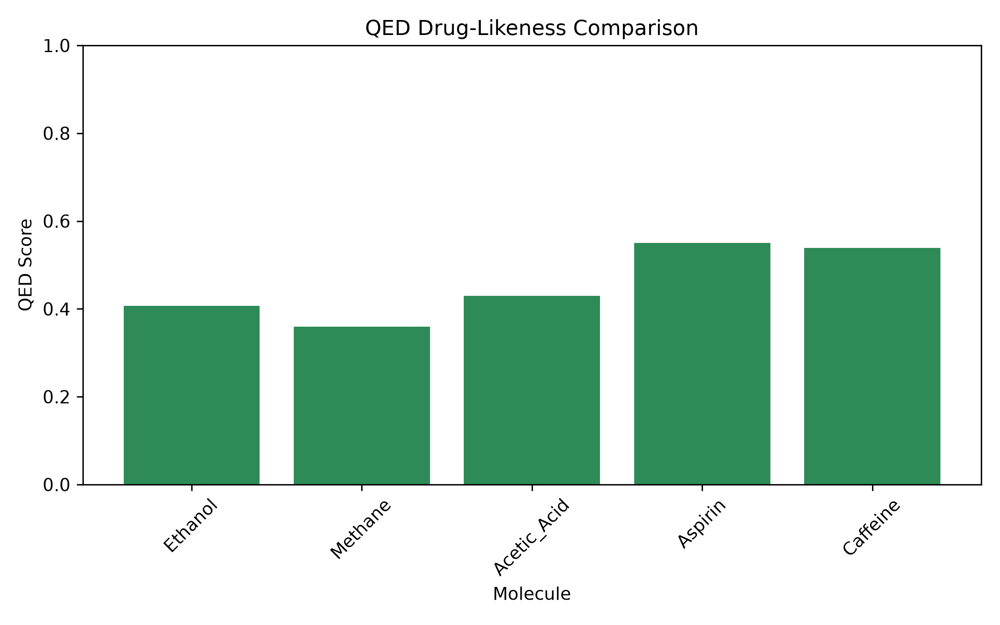

# Molecular Descriptor Calculation and Validation Using RDKit

## Overview
This project calculates physicochemical descriptors for molecules from SMILES strings using RDKit, validates the results, and visualises them.

## Features
- SMILES to molecule conversion and 2D drawing
- Descriptors: molecular weight, exact molecular weight, LogP, TPSA, HBD, HBA, rotatable bonds, ring count, heavy atom count, Fraction CSP3, QED
- Batch processing of multiple molecules into a pandas DataFrame
- Export of results to CSV
- Validation: invalid SMILES handling, molecular weight check, finite-value check, reproducibility test
- Lipinski Rule of Five analysis
- Visualisation of molecular weight and QED with Matplotlib

## Molecules Analysed
Ethanol, methane, acetic acid, aspirin, caffeine

## Sample Results
| Molecule | Molecular Weight | LogP | TPSA |
|----------|------------------|------|------|
| Ethanol | 46.069 | -0.0014 | 20.23 |
| Aspirin | 180.159 | 1.3101 | 63.60 |
| Caffeine | 194.194 | -1.0293 | 61.82 |

## QED Drug-Likeness Plot

## Installation
pip install rdkit pandas numpy matplotlib jupyter

## Usage
Open `Molecular_Descriptor_Calculation.ipynb` in Jupyter Notebook and run all cells.

## Tools
Python, RDKit, pandas, NumPy, Matplotlib, Jupyter Notebook

## Author
Anwesha Patnaik